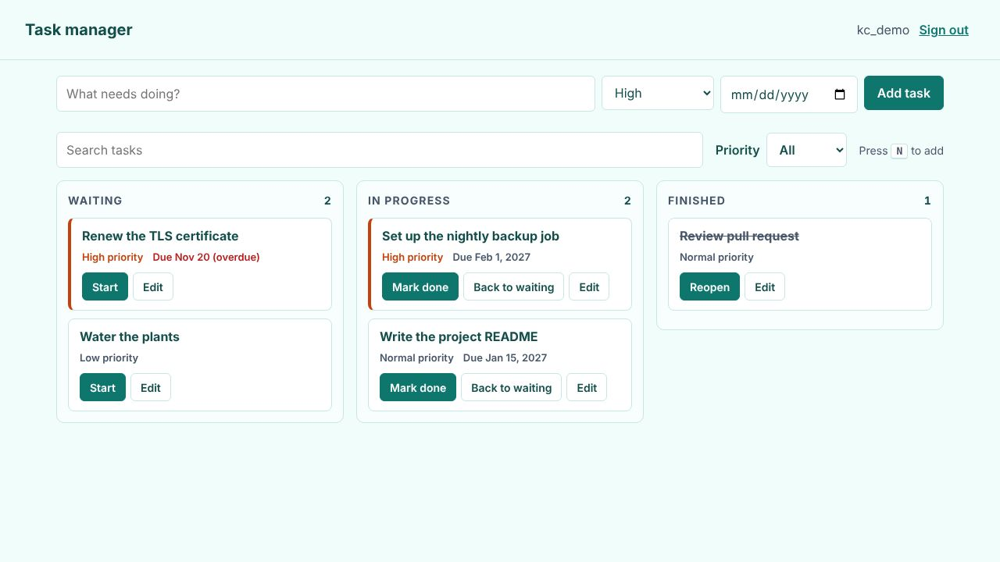

<h1 align="center">Cloud Task Manager</h1>

<p align="center"><b>Task manager with accounts, in plain JavaScript and the JDK alone.</b></p>

<p align="center">
     
</p>

<p align="center">
  <picture>
    <source media="(prefers-color-scheme: dark)" srcset="docs/dark.jpg">
    
  </picture>
</p>

A task manager with user accounts, task creation and status tracking. The page is plain HTML, CSS and JavaScript; the backend is Java using only what ships with the JDK. There is no framework, no database server and no paid service. It's meant to run on a small cloud virtual machine.

Each person signs in and sees only their own tasks, laid out in three columns: Waiting, In progress and Finished. Every status change is recorded with a timestamp.

## Features

- Sign up and sign in with a username and password (10 characters minimum).
- Add tasks with a title, notes, priority (low, normal, high) and an optional due date.
- Move tasks between columns, edit or delete them, search, and filter by priority. Overdue tasks say "overdue" in words.
- Light and dark themes that follow the system setting; works by keyboard (`N` jumps to the new-task box) and on a phone, where the columns become tabs.
- Data is saved to a single JSON file written atomically, so a crash can't leave it half-written.

## Run it

Needs JDK 17 or newer (built and tested on 21).

```bash
cd server
mkdir -p build && javac -d build $(find src -name '*.java')
java -cp build taskmanager.Main          # http://127.0.0.1:8080
```

| Setting | Default | |
| --- | --- | --- |
| `PORT` | `8080` | |
| `BIND` | `127.0.0.1` | use `0.0.0.0` only inside a container or behind a firewall |
| `DATA_DIR` | `data` | where `data.json` is kept |
| `WEB_DIR` | `../web` | the front-end files |
| `SECURE_COOKIES` | `false` | set `true` when served over HTTPS (also adds the HSTS header) |
| `TRUST_PROXY` | `false` | set `true` behind a reverse proxy so login limits use the real client address |

## Tests

```bash
cd server && mkdir -p build && javac -d build $(find src test -name '*.java') && java -cp build taskmanager.TaskManagerTest
```

21 checks. The last eight start the real server and talk to it over HTTP: sign-up and sessions, the full task lifecycle, validation messages, one user trying to reach another's tasks, cross-site requests, request limits and login rate limiting.

## Security

| Area | What it does |
| --- | --- |
| Passwords | PBKDF2-HMAC-SHA256, 210,000 iterations, random salt per password; compared in constant time |
| Sign-in errors | One message for a wrong username or a wrong password, and the same work is done for both, so usernames can't be probed |
| Sessions | Random 256-bit token in an `HttpOnly`, `SameSite=Strict` cookie (plus `Secure` over HTTPS). Only a hash of the token is kept on the server. They last 7 days and end on sign-out or restart |
| Access control | Every task query is scoped to the signed-in user. Someone else's task answers 404, the same as a missing one |
| Cross-site requests | Changes need an `X-Requested-With` header a foreign page can't send, and a mismatched `Origin` is refused |
| Brute force | 5 sign-in attempts per address and username per 5 minutes; 10 sign-ups per address per hour |
| Input | Every field is validated on the server with a message per field; bodies are JSON only and capped at 64 KB; 500 tasks per user |
| Output | The page builds its DOM with `textContent` (no HTML injection) and a strict Content-Security-Policy blocks inline scripts and styles |
| Errors | Unexpected failures return a generic message; details go to the server log only |

## Deploy to a cloud VM

Any small Linux VM from any provider works. The app and its tests were run locally. The deployment files are untested on a real VM: the setup script only had a syntax check, and the Docker image is built by the CI workflow on every push, so check that run is green before relying on it.

**Option 1: systemd and Caddy (Ubuntu or Debian)**

```bash
git clone https://github.com/KCarnage1/cloud-task-manager && cd cloud-task-manager
sudo ./deploy/setup.sh        # installs the JDK, builds, and starts the service on 127.0.0.1:8080
```

Then install [Caddy](https://caddyserver.com) and use `deploy/Caddyfile` (with your domain) so the app is served over HTTPS. Caddy obtains and renews the certificate itself. The service runs as a throwaway user with a read-only filesystem except its own data folder.

**Option 2: Docker**

```bash
docker build -t task-manager .
docker run -d --restart unless-stopped -p 127.0.0.1:8080:8080 -v task-data:/data \
  -e SECURE_COOKIES=true -e TRUST_PROXY=true task-manager
```

Put it behind Caddy or any HTTPS proxy as above. Back up by copying `data.json` from the data folder or volume.

## Limits

- Storage is one JSON file loaded into memory. That suits one person or a small team, not thousands of users.
- There is no password reset: it would need email. Keep your password safe.
- Sessions are held in memory, so everyone signs in again after a restart.
- No drag and drop; moving a task uses buttons, which also works by keyboard and on touch screens.

## Project layout

```text
server/src/taskmanager/   Main, Server (HTTP and routes), Store (JSON file), Passwords, RateLimiter, Validation, Json
server/test/              TaskManagerTest: 21 checks, the last eight over real HTTP
web/                      index.html, app.js, style.css
deploy/                   setup.sh, task-manager.service, Caddyfile
Dockerfile                container image, built by CI on every push
```

## Licence

MIT

Part of my [portfolio](https://kcarnage1.github.io/My-Persona-Portfolio/).
